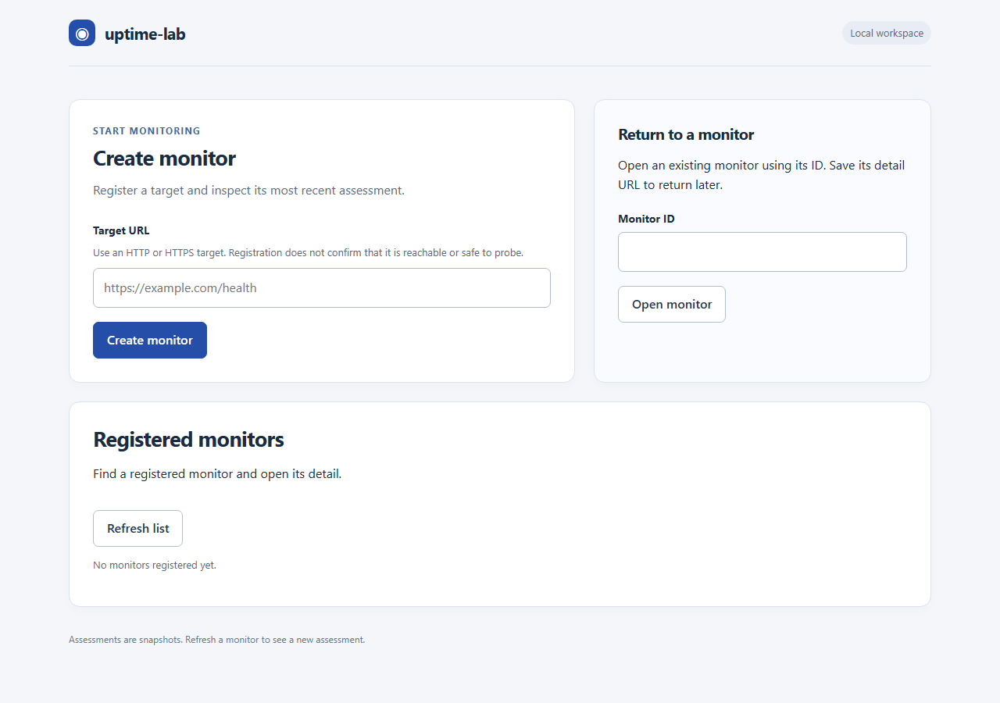
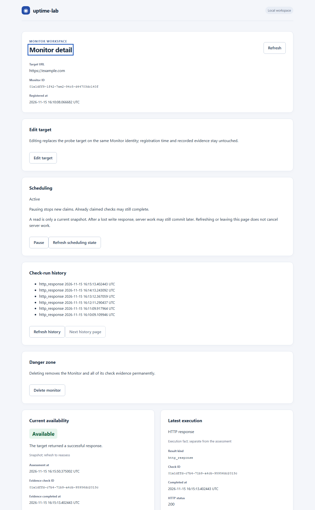
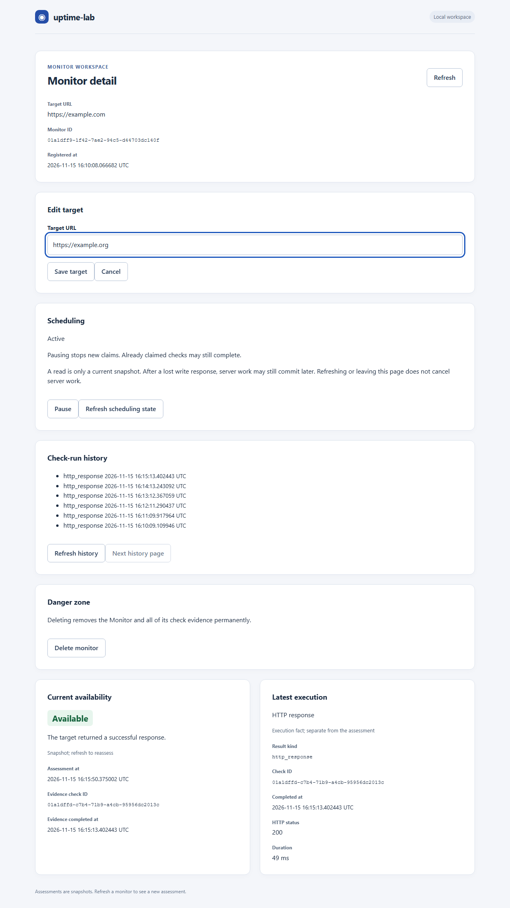
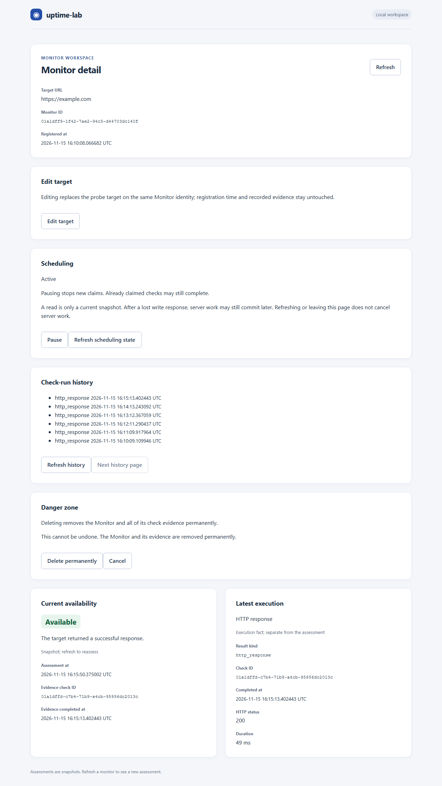
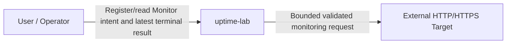

# uptime-lab

A production-disciplined uptime monitoring laboratory built around explicit boundaries between a React/TypeScript web client, a Go Control Plane, a Rust Checker, and PostgreSQL.

Current availability is exposed by `GET /monitors/{monitorId}/availability` as a read-only assessment of the latest terminal CheckRun. It returns `status`, `reason`, UTC `evaluatedAt`, and terminal `evidence` (`checkId`, `completedAt`). A known Monitor without a terminal result returns `200 unknown/no_result` with evidence omitted; the raw latest-result route retains its empty `204`. Every matched availability response, including errors and `405`, uses `Cache-Control: no-store`; `HEAD` returns `405` with `Allow: GET`. No new persistence, reconciliation, history, or public deployment is introduced.

## Status

uptime-lab is not a production-ready public monitoring service.

The **Single-Checker Execution Vertical Slice and the R2 local monitor-management increments are implemented**. The repository now contains:

- the real Go Control Plane runtime;
- Monitor registration/read plus local pause/resume, delete, bounded check-run history and target-URL edit;
- Go-owned due-work coordination and CheckRun persistence;
- the internal Go/Rust claim/result contract;
- the real Rust Checker with bounded HTTP/HTTPS execution;
- deny-by-default production destination policy;
- PostgreSQL migrations for `monitoring.monitors` and `monitoring.check_runs`;
- schema-aware readiness;
- a real four-service Docker Compose topology;
- cross-runtime Docker evidence from claim through terminal CheckRun persistence and public latest-result readback.

The public Monitoring contract at `contracts/openapi/public.yaml` contains ten operations: `POST /monitors`, `GET /monitors`, `GET /monitors/{monitorId}`, `GET /monitors/{monitorId}/latest-result`, `GET /monitors/{monitorId}/availability`, `GET /monitors/{monitorId}/scheduling`, `PUT /monitors/{monitorId}/scheduling`, `DELETE /monitors/{monitorId}`, `GET /monitors/{monitorId}/history`, and `PATCH /monitors/{monitorId}`. The local browser discovers durable registrations and displays independent detail snapshots through a restricted same-origin gateway, with pause/resume, confirmed delete, bounded check-run history and target-URL edit controls. Pending work is invisible; raw `204` differs from availability `unknown/no_result`. The newest-50 terminal-row retention window is enforced inside claim reconciliation. Authentication/authorization and remote ingress/TLS remain deferred. See [local browser startup](docs/devops/local-development.md).

Inventory uses persisted creation-time/UUID keyset positions, default20/max50 rows and a245760-byte JSON budget. The start page replaces one20-row page at a time, with Next, Refresh and manual Retry. Targets remain complete text. A first eligible target that cannot fit returns fixed500 and blocks older traversal without truncation or skipping. Listing provides no ownership or authorization boundary and remains local-only.

## Demo

The screenshots below come from the real four-service Compose stack (no mocked UI), probing a public HTTPS target end to end: Go coordinates due work, Rust executes the bounded probe, and the browser reads Go-owned snapshots through the restricted same-origin gateway.

1. **Register a target.** The start page creates a Monitor and lists durable registrations.

   

2. **Read independent snapshots.** The detail page separates the current availability assessment from the raw latest execution fact and shows bounded check-run history.

   

3. **Edit the target.** Editing replaces the probe target on the same Monitor identity; registration time and recorded evidence stay untouched.

   

4. **Delete with confirmation.** Deletion removes the Monitor and all of its check evidence permanently.

   

Private and non-public destinations are deny-by-default in the production Checker and surface as `policy_rejected`, so the demo uses a public target. To reproduce locally, follow [local development](docs/devops/local-development.md) and open `http://127.0.0.1:4173`.

## Architecture

- **React + TypeScript** owns local registration, bounded inventory, reopen and manual refresh in `apps/web`; its Node gateway forwards only the ten public Go operations.
- **Go** owns product/domain coordination, public and internal API semantics, scheduling truth, PostgreSQL persistence, migrations, readiness, and CheckRun completion semantics.
- **Rust** owns bounded network execution, destination validation, HTTP/HTTPS probing, transport normalization, and result delivery. Rust never accesses PostgreSQL directly.
- **PostgreSQL** holds durable product state owned exclusively through Go. The Monitoring namespace contains `monitoring.monitors` and `monitoring.check_runs`.
- **Docker Compose** runs PostgreSQL, Go, Rust and compiled Web without canonical host ports. The explicit `compose.web-local.yaml` override exposes only Web on `127.0.0.1:4173` (configurable).

C4 Level 1 system context (full view in [system context](docs/architecture/system-context.md)):

Start with the [architecture index](docs/architecture/README.md), the [Go Control Plane guide](docs/backend/go-control-plane.md), and the [Rust Checker guide](docs/checker/rust-checker.md).

## Local Development

See [docs/devops/local-development.md](docs/devops/local-development.md) for the canonical four-service topology, explicit migrations, persistence/reset semantics, worktree isolation, and cross-runtime smoke commands.

## Testing

- [Go Monitoring Foundation](docs/testing/go-monitoring-foundation.md)
- [Go Public Monitoring Transport](docs/testing/go-public-transport-adapter.md)
- [Public Monitoring Contract](docs/testing/public-monitoring-contract.md)
- [Single-Checker Execution Slice](docs/testing/single-checker-execution-slice.md)

The execution-slice guide separates internal-contract, Go/PostgreSQL, Rust policy/probe/client/worker, Docker cross-runtime, race, and vulnerability evidence.

## Engineering Principles

- Boundaries before abstractions.
- Contract-driven runtime integration.
- One owner per source of truth.
- Tests at the cheapest meaningful layer.
- Security and observability are design constraints, not release-time patches.
- No distributed infrastructure without a concrete requirement.

## Repository Workflow

`main` is the only long-lived branch. Changes use short-lived branches, pull requests, Conventional Commits, required CI, and squash merge.

See [CONTRIBUTING.md](CONTRIBUTING.md) and [docs/devops/repository-governance.md](docs/devops/repository-governance.md).

## Documentation

Start at [docs/README.md](docs/README.md).

## Security

Read [SECURITY.md](SECURITY.md) before reporting a vulnerability or exposing an experimental build to untrusted networks.

## License

Released under the [MIT License](LICENSE). Copyright (c) 2026 Yusuf KEF.
